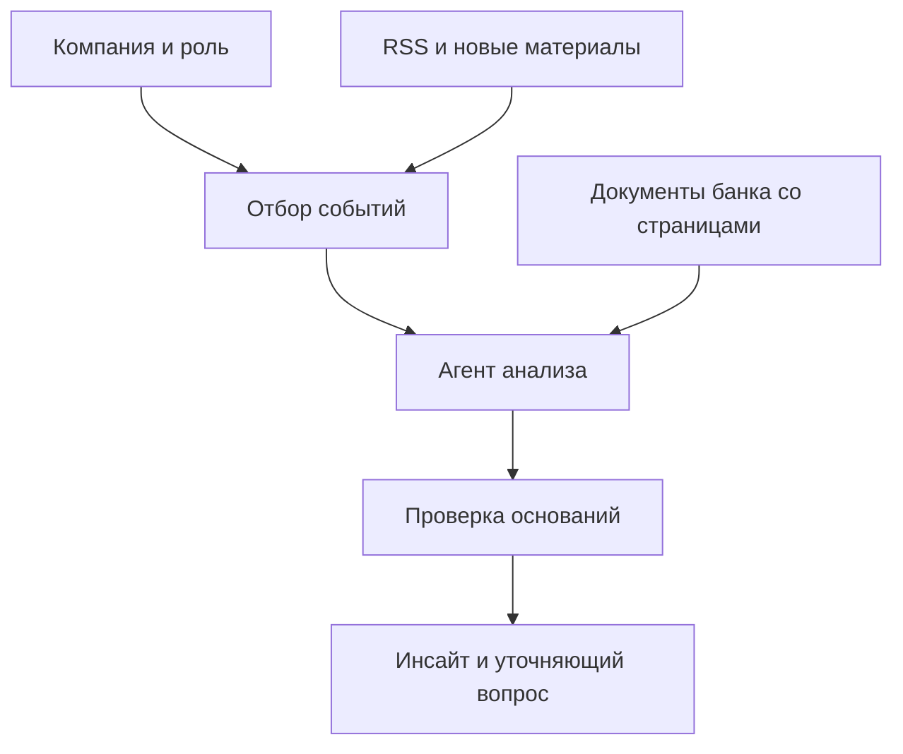

# Альфа · Бизнес-инсайты

Рабочая первая версия решения кейса «Новостная аналитика для принятия бизнес-решений».
Руководитель выбирает компанию и роль, получает отобранные события, запрашивает
персональный разбор и проверяет его основания в материалах Альфа-Банка.

## Что работает

- 85 514 уникальных профилей из переданной базы, поиск по ID, отрасли и городу.
- Контекст выбранного юрлица, группы, банковских продуктов и финансовых взаимодействий.
- Сбор RSS Банка России, РБК и Интерфакса, устранение точных дублей, резервная копия.
- Объяснимый отбор по деятельности, группе и роли; приоритет не является вероятностью.
- 9 банковских документов, 64 распознанные страницы, 174 фрагмента с привязкой к странице.
- Лексический поиск с учётом даты; материал 2021 года не выдаётся за текущую позицию.
- Агентный процесс: план, профиль, поиск, расширение поиска при нехватке контекста,
  генерация, при необходимости дополнительный поиск по запросу модели,
  программная проверка источников и независимый проверяющий вызов LLM.
- Поток статусов существенных шагов; технические логи не содержат ключей.
- Уточняющие вопросы, ввод неизвестного заранее материала, обратная связь.
- Калькулятор чувствительности процентных расходов по параметрам пользователя.
- Кэширование результата по компании, роли, событию, вопросу и предпосылкам.

## Быстрый запуск через Docker

Требуется Docker с Compose. Ключ в репозиторий не входит.

```sh
cp .env.example .env
# Заполнить LLM_API_KEY своим командным ключом в локальном файле .env.
docker compose up --build
```

Открыть `http://localhost:3000`. Локальная D1/SQLite сохраняется в именованном томе.
Контейнер не требует развёртывать генеративные модели: используется API организаторов.
Docker-конфигурация подготовлена; сам Docker в среде разработки недоступен,
поэтому контейнерная сборка пока не проверена. TypeScript, основной build и
целевые проверки выполняются отдельно. Это пункт ближайшей проверки на машине команды.

Для локальной разработки без Docker: Node.js >=22.13.0, `npm ci`,
`cp .env.example .env`, заполнение ключа в `.env`, `npm run build`, затем `npm start`.
Скрипт запуска автоматически применяет миграции к локальной D1/SQLite.
Для редактирования интерфейса с автоматическим обновлением: `npm run dev`.
Локальные секреты исключены из Git; запускающий эксперт подставляет собственный ключ.

## Конфигурация

| Переменная | Значение |
|---|---|
| `LLM_API_KEY` | Командный секрет; только на сервере |
| `LLM_BASE_URL` | `https://changellenge.up.railway.app/v1` |
| `LLM_MODEL` | По умолчанию `qwen/qwen3.6-35b-a3b` |

Разрешённые модели проверяются серверным allowlist. Ключ не передаётся браузеру.
Защитный лимит первой версии — 80 попыток обращения к LLM в сутки для приложения.
Это дополнительное ограничение, не эквивалент 500 ₽. Денежный лимит обеспечивает
провайдер; точные рублёвые расходы без тарифов не вычисляются. Сброс согласно
инструкции API — 03:00 МСК. Ошибки бюджета и ключа показываются без раскрытия секрета.

## Архитектура



TypeScript, React/Vinext, серверные route handlers, Cloudflare D1 для кэша,
обратной связи и учёта запросов. Предобработка CSV и сканов — воспроизводимые
локальные Python-скрипты. Подготовленные профили разделены на 128 файлов,
чтобы не загружать всю базу в память одного серверного запроса.
Внешние интеграции с банковской авторизацией и CRM смоделированы, не реализованы.

## Данные и воспроизведение подготовки

Сырые CSV/PDF не входят в Git; ссылки организаторов:

- [Клиентские таблицы](https://drive.google.com/drive/folders/1Ep8wWoEHTg5Q8kwrLx2j_xFyxGUEVxFq)
- [Материалы банка](https://drive.google.com/drive/folders/15xZTLF1lZ65p6o5xpNA_fRbxjoV-UlG1)

Подготовленные обезличенные профили и распознанный корпус включены в `public/data`
для автономной воспроизводимости прототипа. Распространяйте данные только в пределах разрешений организаторов;
перед публичным распространением следует уточнить условия использования данных кейса.

```sh
python scripts/prepare-data.py --input /path/to/csv
python scripts/ocr-bank.py --input /path/to/pdf --output /path/to/ocr --tessdata /path/to/tessdata
python scripts/compile-sources.py --ocr /path/to/ocr --manifest /path/to/manifest.json --feeds /path/to/rss
```

OCR требует PyMuPDF и Tesseract 5 с языками rus+eng. Manifest — массив объектов
`{"name":"имя.pdf","source":"публичная ссылка"}`; RSS-копии — `0.xml`, `1.xml`,
`2.xml`, `6.xml` для источников, перечисленных в compile-sources.py.
Бинарный OCR language pack в репозиторий не включён.

Принципы интерпретации:

- `REVENUE_COMPANY=1000` трактуется как пропуск; год выручки — 2025.
- Переводы самому себе исключены из анализа внешних связей.
- Тип отношений по платежу неизвестен; выборка не доказывает полноту бизнеса.
- Групповая сумма выручки не является консолидированной.
- ФТС не раскрывает направление и объём торговли.
- Связь физлица с компанией не раскрывает его должность или полномочия.
- Идентификатор с пустыми повторяющимися записями имеет предупреждение качества.
- Предпосылки пользователя отделяются от данных банка.

## Сценарий проверки

1. Войти в демо как финансовый директор, выбрать `U_9250`.
2. Проверить профиль: инженерное строительство, кредитный продукт, группа.
3. Открыть событие из подборки: дождаться живого хода анализа и проверки.
4. Проверить раздельное отображение новости, вывода AI и датированной позиции банка.
5. Раскрыть фрагмент материала, сверить страницу с оригинальным PDF.
6. Задать «Как это затрагивает группу компаний?».
7. Сменить компанию на `U_182712`, сравнить отбор технологических событий.
8. Добавить неизвестный заранее текст об изменении регулирования или стоимости денег.
9. Ввести плавающий долг 100 млн ₽ и изменение ставки 1 п.п.: ожидается 1 млн ₽/год.
10. Повторить тот же разбор: результат должен вернуться из кэша без нового вызова LLM.

```sh
node scripts/test-core.mjs
npx tsc --noEmit
npm run build
```

## API

| Метод | Путь | Назначение |
|---|---|---|
| GET | `/api/bootstrap` | Примеры, аудит базы, каталог документов |
| GET | `/api/companies?id=U_9250` | Профиль компании |
| GET | `/api/companies?q=строительство` | Поиск по базе |
| GET | `/api/feed?company=U_9250&role=cfo` | Персональный отбор |
| POST | `/api/news` | Новый текст пользователя |
| POST | `/api/analyze` | Разбор, SSE-статусы и результат |
| POST | `/api/analyze?format=json` | Разбор для проверки API |
| POST | `/api/feedback` | Оценка релевантности |

## Безопасность и ограничения

В локальном демо банковская авторизация смоделирована. Это не production-реализация многопользовательских банковских ACL.
Переход к реальным клиентским данным требует авторизации на каждый профиль,
проверки доступа к группе, разграничения данных и политики хранения.
API собирает новости только с заданного списка HTTPS RSS. Пользовательская ссылка
не скачивается сервером. Внешние тексты помечены как недоверенные данные в prompt.
В UI они выводятся как текст, без выполнения HTML. Неподтверждённые ссылки на
материалы и признаки отвергаются программно. Повторная проверка LLM не гарантирует
истинность: нужна экспертная оценка и набор контрольных кейсов.

## План следующих итераций

См. `docs/FIVE_DAY_PLAN.md`. Текущая версия — проверяемая основа первого дня,
а не финальная заявка на победу. До сдачи нужны GitHub-репозиторий с историей,
фиксированный commit/tag, проверка контейнера, экспертные сценарии и демонстрация.

## Работа команды

Репозиторий предназначен для совместной разработки. Основная ветка начинается
с импорта исходного прототипа. Дальнейшие изменения оформляются в отдельных
ветках и объединяются через Pull Request. Не перезаписывайте общую историю
после начала совместной работы.

- `app/page.tsx`, `app/globals.css` — пользовательский интерфейс.
- `app/api/` — серверные обработчики.
- `lib/` — отбор новостей, поиск и проверка аналитики.
- `scripts/` — подготовка данных, локальный запуск и проверки.
- `wrangler.jsonc` — стандартная конфигурация Worker и локальной D1.

Проверки перед объединением: `npm run typecheck`, `npm test`, `npm run build`.
Рабочая версия Node.js — 22.16.0; минимальная — 22.13.0. Для локального запуска
аккаунт Cloudflare не требуется. Публикация в собственном Cloudflare-аккаунте
потребует создать реальную D1 и заменить технический database_id в конфигурации.

После сборки доступна интеграционная проверка `npm run test:smoke`: она запускает
локальный сервер, проверяет страницу, базу, поиск и валидацию запроса, затем
останавливает сервер. Вызовы генеративной модели эта проверка не выполняет.
